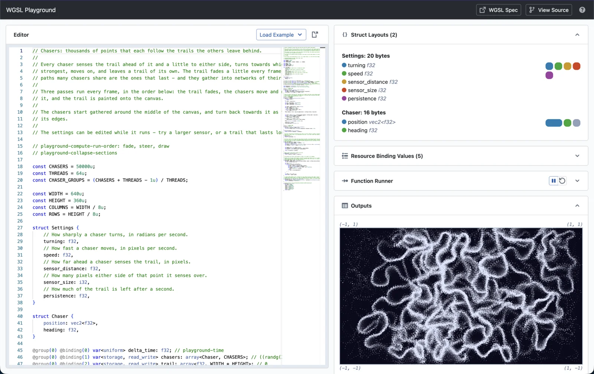

## WGSL Playground

This is a simple webapp for experimenting with [WGSL](https://www.w3.org/TR/WGSL/) code, the language used for running GPU code in the browser.

It is hosted here: https://wgsl.hms.dev/

Sometimes I like to write [little projects](https://github.com/Athenodoros/Chasers) in WGSL, and have been frustrated by the iteration cycle for testing small functions and syntax. If you've had that problem - maybe this could be useful for you too!
